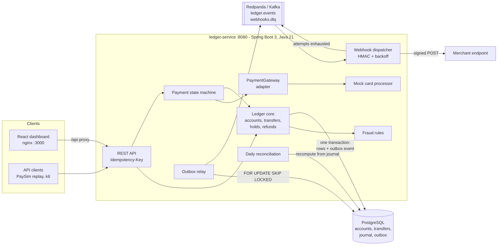

# TallyForge

[](https://github.com/Vrajesh-works/TallyForge/actions/workflows/ci.yml)

TallyForge is a double-entry payments ledger where money is only ever transferred, never created, lost or charged twice. Every movement is a balanced pair of journal entries with TigerBeetle-style pending/posted two-phase holds. Client retries are made safe by idempotency keys. Events leave the database through a transactional outbox relayed to Kafka. A Kill Bill style payment state machine drives a pluggable card gateway, merchants get HMAC-signed webhooks with exponential backoff and a dead-letter topic, and a daily reconciliation job recomputes every balance from the journal. Suspicious transfers are held by rule-based fraud checks modelled on the PaySim dataset. A React dashboard lets operators filter, review and export transactions. Everything runs locally with one command.

**Stack:** Java 21, Spring Boot 3.5, PostgreSQL 16, Kafka (Redpanda), React 18 + TypeScript (Vite), Docker Compose, JUnit 5 + Testcontainers, Vitest, k6, GitHub Actions.

## Architecture



More detail (data model, flows, test strategy) is in [docs/PLAN.md](docs/PLAN.md); the product framing is in [docs/PRODUCT.md](docs/PRODUCT.md).

## Quick start

Requirements: Docker with Compose. Nothing else is needed to run the stack.

```bash
make up            # or: docker compose up --build -d
```

- Dashboard: http://localhost:3000
- API: http://localhost:8080 (health at `/actuator/health`)

Load demo traffic (500 PaySim-shaped transactions, Python 3 standard library only):

```bash
make seed
```

Try the API by hand:

```bash
BANK=$(curl -s localhost:8080/api/v1/accounts -H 'Content-Type: application/json' \
  -d '{"code":"bank","name":"Bank","currency":"USD","flags":"NONE"}' | jq -r .id)
ALICE=$(curl -s localhost:8080/api/v1/accounts -H 'Content-Type: application/json' \
  -d '{"code":"alice","name":"Alice","currency":"USD","flags":"DEBITS_MUST_NOT_EXCEED_CREDITS"}' | jq -r .id)

# Fund Alice. Repeating this exact request with the same key returns the first response.
curl -s localhost:8080/api/v1/transfers -H 'Content-Type: application/json' \
  -H 'Idempotency-Key: fund-alice-1' \
  -d "{\"debitAccountId\":\"$BANK\",\"creditAccountId\":\"$ALICE\",\"amount\":50000}"
```

Ports can be moved with `API_PORT`, `DASHBOARD_PORT`, `PG_PORT` and `KAFKA_PORT`. `make down` stops the stack and deletes its volume.

### API overview

| Endpoint | Purpose |
| --- | --- |
| `POST /api/v1/accounts`, `GET /api/v1/accounts[/{id}]` | Accounts with TigerBeetle-style balance flags |
| `POST /api/v1/transfers` | Move money, optionally `pending: true` to place a hold |
| `POST /api/v1/transfers/{id}/post` / `void` | Settle (fully or partially) or release a hold |
| `POST /api/v1/transfers/{id}/refunds` | Reverse part or all of a posted transfer, capped at the posted amount |
| `GET /api/v1/transfers` | Filter by status, kind, account, date, amount, fraud hold, reference; paginated |
| `GET /api/v1/transfers/export` | Same filters as CSV |
| `POST /api/v1/payments`, `/{id}/approve`, `/capture`, `/void`, `/refunds` | Card payment state machine |
| `POST /api/v1/webhook-endpoints`, `GET /api/v1/webhook-deliveries` | Merchant webhooks |
| `POST/GET /api/v1/reconciliation/runs` | Run or list reconciliation checks |

Every money-moving POST accepts an `Idempotency-Key` header. Amounts are integer minor units (cents).

## Running the tests

```bash
make test          # dashboard checks + ledger unit and integration tests
make test-unit     # ledger unit tests only, no Docker needed
make lint          # Spotless (google-java-format) + ESLint
```

| Suite | Count | What it covers |
| --- | --- | --- |
| Ledger unit (JUnit 5) | 73 | Payment transition table, HMAC signing, backoff, fraud rules, CSV escaping, request hashing, balance flags |
| Ledger integration (Testcontainers: PostgreSQL + Redpanda) | 30 | Transfers, holds, refunds, idempotent retries (sequential and concurrent), outbox to a real broker, webhook retries and DLQ, reconciliation catching injected drift, fraud holds, search and export |
| Concurrency (`ConcurrentTransfersIT`) | 2 | 16 threads fire 200 overlapping debits at one wallet (twice its balance) and 600 random transfers among 8 wallets: no overdraft, total money unchanged, journal debits equal credits |
| Dashboard (Vitest) | 9 | Exact cents formatting, amount parsing, filter to query-string mapping |

CI runs all of it on every pull request and push to `main`, plus Docker image builds.

### Load test

`load/transfers.js` drives 200 idempotent transfers per second for 30 seconds across 50 funded wallets:

```bash
docker run --rm --network host -i grafana/k6:0.54.0 run - < load/transfers.js
```

Measured on a laptop (WSL2, whole stack in Docker Compose): **p95 10.4 ms, p90 8.3 ms, median 4.9 ms, 0 failed requests out of 6,102**. A reconciliation run straight after the load test and a PaySim replay checked 303 accounts and 7,252 transfers with 0 mismatches.

The PaySim replay (`make seed`) of 500 rows reported a p95 of 11.7 ms. All 26 fraud-labelled rows were either held for review or rejected: 5 account-draining transfers were held, and the matching cash-outs failed for lack of funds.

## Design notes

- **Money is only moved.** An account stores `debits_pending`, `debits_posted`, `credits_pending` and `credits_posted`. Each transfer writes exactly one debit line and one credit line to `journal_entries`, so the sum of debits always equals the sum of credits. Accounts flagged `DEBITS_MUST_NOT_EXCEED_CREDITS` count pending debits too, so a hold really reserves funds.
- **Two-phase transfers.** `PENDING` reserves, `post` settles up to the held amount and releases the rest, and `void` releases everything. Card authorizations are holds from a clearing account to the merchant; capture posts the hold.
- **Exactly-once API effects.** The idempotency row `(scope, key, request_hash)` is inserted in the same transaction as the money movement. A concurrent duplicate blocks on the primary key and then replays the stored response. Reusing a key with a different body returns `422`.
- **Concurrency.** Accounts use JPA optimistic locking. Version conflicts, deadlocks and serialization failures roll back the whole transaction, idempotency row included. It is then retried with jittered exponential backoff, up to a bound, before returning `409`.
- **Transactional outbox.** Ledger rows and their event commit together. A relay claims unpublished rows with `FOR UPDATE SKIP LOCKED`, so several instances can run without double-publishing. It sends them to Kafka keyed by aggregate id and marks a row published only after the broker ack. Delivery is at least once, and the event id is the consumer's dedupe key.
- **Webhooks.** One delivery row per endpoint per event is unique, so Kafka redelivery cannot duplicate a webhook. Each delivery is signed with `TallyForge-Signature: t=<unix>,v1=<HMAC-SHA256(secret, t.body)>`. Failed attempts are rescheduled with capped exponential backoff with jitter, and once attempts are exhausted the delivery is published to `tallyforge.webhooks.dlq`.
- **Fraud holds.** Rules run before a transfer settles:
  - `LARGE_AMOUNT`: the amount is at or above a threshold.
  - `DRAINS_ACCOUNT`: a transfer would empty a customer wallet (the PaySim TRANSFER-then-CASH_OUT pattern).
  - `VELOCITY`: too many debits from one wallet in a time window.

  A flagged transfer is created `PENDING` with a `hold_reason`, and a reviewer posts or voids it from the dashboard. A large card payment goes to `REQUIRES_REVIEW` and needs `approve` before it can be captured.
- **Reconciliation.** Runs daily at 02:00 UTC and on demand, inside one repeatable-read snapshot. It checks:
  - each account's balance columns against its journal;
  - debits against credits per currency;
  - transfer posted amounts against their entries;
  - each captured payment against its ledger transfer.
- **Cloud-ready, not cloud-bound.** Kafka, the gateway and the scheduler sit behind interfaces and configuration, so AWS (SQS, RDS, ECS) can be added later as adapters (see the roadmap below).

## What broke and how I fixed it

- **New rows were merged instead of inserted.** Entities have application-assigned UUIDs. With a primitive `long` version, Spring Data could not tell a new entity from an existing one, so `save()` called `merge()` and issued a needless SELECT that could fail the optimistic lock check. Making `@Version` a nullable `Long` lets Spring Data see `null` as "new" and call `persist()`.
- **Deadlocks under parallel transfers.** The concurrency test made PostgreSQL report `deadlock detected` when two transfers updated the same pair of accounts in opposite order. Spring translates the deadlock into a `ConcurrencyFailureException`, so the retry wrapper now treats it like a version conflict and reruns the whole transaction, idempotency row included. The test asserts that money is conserved and no wallet overdraws, even while deadlocks are logged.
- **The fraud screen held the bank's own funding.** The first PaySim replay put every opening balance on hold: the velocity rule counted the bank account, which funds dozens of wallets a minute. Drain and velocity rules now apply only to customer wallets (no-overdraft accounts), and settlement accounts are screened on amount only. A unit test pins this.
- **The replay under-funded wallets.** Customers first seen as a *recipient* were never given their PaySim opening balance, so their later spending bounced. The replay now funds a customer the first time it sends money. The remaining rejections are wallets downstream of a held fraud transfer, because the generator assumes every transfer settled.
- **PaySim needs a Kaggle login.** The real dataset cannot be downloaded in CI, so `scripts/paysim_replay.py --generate N` writes a synthetic file with the exact PaySim columns and type mix, including the draining fraud pattern. To use the real data, download `PS_20174392719_1491204439457_log.csv` from Kaggle and run `python3 scripts/paysim_replay.py --file <path> --limit 5000`.
- **Docker vanished after a reboot.** The WSL2 Docker Desktop integration was not running, so Testcontainers could not start. Unit tests stay Docker-free so they always run locally. CI runs the Testcontainers suite on GitHub-hosted runners, which have Docker.

## Project layout

```
ledger-service/   Spring Boot service (Maven wrapper, Flyway migrations, tests)
dashboard/        React + TypeScript dashboard (Vite, Vitest, nginx image)
scripts/          PaySim-shaped generator and replay
load/             k6 load test
docs/             Product doc and technical plan
```

## Roadmap

Deferred on purpose and listed in [docs/PLAN.md](docs/PLAN.md#future-work):

- AWS deployment (ECS Fargate or EKS, RDS PostgreSQL, MSK or SQS) and a live demo link
- Terraform modules for the AWS stack
- SQS adapter for the outbox relay and webhook queue
- Secrets management for webhook secrets and database credentials
- AuthN/AuthZ for the API and dashboard
- Real gateway adapters (Stripe, Adyen) behind `PaymentGateway`
- Multi-currency/FX, linked batch transfers, hold timeouts
- Open-source contributions to Apache Fineract (to be listed separately once merged)

## Built with / inspired by

- [TigerBeetle](https://github.com/tigerbeetle/tigerbeetle) and its [concepts docs](https://docs.tigerbeetle.com/concepts/): design reference for the "money is only transferred" model, the four balance columns, account balance flags and pending/posted two-phase transfers. No code was used.
- [Kill Bill](https://github.com/killbill/killbill): design reference for the explicit payment state machine, gateway retries and plugin-style gateway adapters. No code was used.
- [PaySim](https://www.kaggle.com/datasets/ealaxi/paysim1) (Lopez-Rojas, Elmir and Axelsson, EMSS 2016): data schema and fraud pattern for the replay generator and the account-draining hold rule.
- Spring Boot, Testcontainers, Redpanda, React, Vite and k6 as the tooling listed above.

## License

[MIT](LICENSE)
