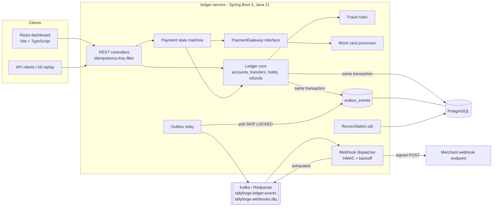

# TallyForge - Technical Plan

## Architecture

TallyForge runs locally as a small set of containers. The ledger service is a modular
Spring Boot application: each package (accounts, transfers, payments, outbox, webhooks,
reconciliation, fraud) owns its tables and talks to the others through Java interfaces,
so any module can later be split out or backed by a cloud service.

### Key flows

**Transfer with idempotency.** `POST /api/v1/transfers` with `Idempotency-Key: k`.
In one database transaction the service inserts `(scope, k, request_hash)` with
`ON CONFLICT DO NOTHING`. If the row already exists (a concurrent duplicate blocks on the
unique index until the first transaction commits), the stored response is returned instead
of executing again; a different request hash under the same key returns `422`.
Otherwise the transfer runs, the response is stored on the key row, and everything commits together.

**Two-phase hold.** `pending: true` creates a transfer in `PENDING`, adding the amount to
`debits_pending` / `credits_pending` of the two accounts. Balance constraints count pending
amounts, so a hold reserves funds. `POST /transfers/{id}/post` moves up to the held amount from
pending to posted (releasing any remainder); `POST /transfers/{id}/void` releases it.

**Concurrency.** Accounts carry a JPA `@Version`. A transfer loads both accounts, checks
constraints and writes; a concurrent writer causes an optimistic lock failure, and the whole
transaction (including the idempotency row) is retried with jittered backoff, up to a bound.

**Outbox.** Every ledger change appends an `outbox_events` row in the same transaction.
The relay polls unpublished rows with `FOR UPDATE SKIP LOCKED`, sends them to Kafka keyed by
aggregate id, waits for the broker ack, then marks them published. Delivery is at least once;
the event id is the dedupe key for consumers.

**Payments.** A payment moves through an explicit transition table; illegal transitions are
rejected with `409`. Each transition calls the `PaymentGateway` adapter and then the ledger:
authorize creates a hold from the card clearing account to the merchant account, capture posts
it, void releases it, refund creates a reversing transfer. Transient gateway errors are retried
with exponential backoff.

**Webhooks.** A Kafka consumer turns each ledger event into one delivery row per active
endpoint (unique on endpoint + event, so redelivered Kafka messages do not duplicate).
A scheduled dispatcher POSTs due deliveries with header
`TallyForge-Signature: t=<unix>,v1=<hex HMAC-SHA256(secret, t + "." + body)>`.
Failures reschedule at `base * 2^attempt` (capped, with jitter); after the max attempts the
delivery is marked `DEAD` and published to `tallyforge.webhooks.dlq`.

**Reconciliation.** Runs daily (cron) and on demand. It recomputes every account's pending and
posted totals from journal entries, compares them with the stored balance columns, checks that
total debits equal total credits per currency, and checks each captured payment against its
ledger transfer. Mismatches are stored with the run and exposed through the API and dashboard.

## Data model

| Table | Purpose | Key columns |
| --- | --- | --- |
| `accounts` | Balances and constraints | `id`, `code` (unique), `name`, `currency`, `debits_pending`, `debits_posted`, `credits_pending`, `credits_posted`, `flags`, `version` |
| `transfers` | One row per money movement | `id`, `debit_account_id`, `credit_account_id`, `amount`, `posted_amount`, `refunded_amount`, `currency`, `kind` (`TRANSFER`, `REFUND`), `status` (`PENDING`, `POSTED`, `VOIDED`), `refund_of`, `hold_reason`, `reference`, `created_at` |
| `journal_entries` | Double-entry lines | `transfer_id`, `account_id`, `side` (`DEBIT`/`CREDIT`), `phase` (`PENDING`/`POSTED`), `amount` (signed, so releasing a hold is a negative pending line) |
| `idempotency_keys` | Exactly-once responses | `scope`, `key`, `request_hash`, `response_status`, `response_body` |
| `outbox_events` | Transactional outbox | `id`, `aggregate_type`, `aggregate_id`, `event_type`, `payload`, `created_at`, `published_at` |
| `payments` | Payment state machine | `id`, `merchant_account_id`, `amount`, `captured_amount`, `refunded_amount`, `currency`, `status`, `gateway_reference`, `hold_transfer_id`, `failure_reason` |
| `payment_events` | Audit trail of transitions | `payment_id`, `from_status`, `to_status`, `at` |
| `webhook_endpoints` | Merchant subscriptions | `id`, `url`, `secret`, `active` |
| `webhook_deliveries` | Delivery attempts | `endpoint_id`, `event_id` (unique pair), `status`, `attempts`, `next_attempt_at`, `last_error` |
| `reconciliation_runs` / `reconciliation_mismatches` | Daily check results | `run_id`, `check_name`, `subject`, `expected`, `actual` |

Amounts are `bigint` minor units (cents). No floating point anywhere in money paths.

## Milestones (today)

1. Product doc and plan (this file).
2. Service scaffold: Maven wrapper, Spring Boot 3, Flyway, PostgreSQL, Testcontainers base test.
3. Accounts, transfers, journal entries, holds (post/void), refunds.
4. Idempotency keys.
5. Parallel transfer concurrency test.
6. Transactional outbox and Kafka relay.
7. Payment state machine, gateway adapter interface, mock card processor.
8. Signed webhooks with backoff and dead-letter topic.
9. Reconciliation job.
10. Rule-based fraud holds.
11. React dashboard (transactions, filters, CSV export, accounts, reconciliation).
12. Docker Compose one-command stack, Dockerfiles.
13. CI workflow, PR and issue templates.
14. PaySim-shaped generator and k6 replay (stretch).
15. README with architecture, design notes, what broke, credits.

## Test strategy

| Layer | Tooling | What it proves |
| --- | --- | --- |
| Unit | JUnit 5, AssertJ | Payment transition table, webhook signature and verification, backoff schedule, fraud rules, request hashing. Run without Docker. |
| Integration | Spring Boot Test, Testcontainers (PostgreSQL, Redpanda) | Transfer API, holds, refunds, balance constraints, idempotent retries (sequential and concurrent), outbox relay to a real broker, webhook delivery to a local HTTP server with retries and DLQ, reconciliation detects injected drift. |
| Concurrency | JUnit 5 + `ExecutorService` against Testcontainers PostgreSQL | Many threads transferring among accounts: total money unchanged, no account violates its constraint, journal debits equal credits. |
| Frontend | Vitest, ESLint, `tsc --noEmit` | CSV export formatting, filter query building, type safety. |
| Load (stretch) | k6 + PaySim-shaped CSV | p95 latency of the transfer endpoint. |

CI runs all of the above on every pull request and push to `main`
(GitHub-hosted runners provide Docker for Testcontainers).

## Future work

Deferred on purpose; the code keeps each behind an interface or config so it is an adapter, not a rewrite.

- **AWS deployment**: ECS Fargate (or EKS) for the service and dashboard, RDS PostgreSQL, MSK or SQS.
- **Terraform** modules for the AWS stack, with remote state.
- **SQS adapter** for the outbox relay and webhook queue as an alternative to Kafka.
- **Live demo link** once a cloud deploy exists.
- **Secrets management** (AWS Secrets Manager) for webhook secrets and database credentials.
- AuthN/AuthZ (OAuth2 client credentials for the API, SSO for the dashboard).
- Real gateway adapters (Stripe, Adyen) behind the existing `PaymentGateway` interface.
- Multi-currency and FX transfers; linked (atomic batch) transfers; hold timeouts.
- Open-source contributions to Apache Fineract (listed separately when merged).
